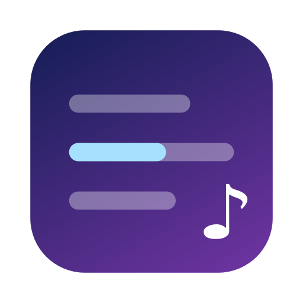

# Lyrics Overlay (Swift)

메뉴바 가사 앱의 Swift/SwiftUI 버전. 상위 폴더의 Python 버전을 대체한다.



## 기능

| 화면 | 내용 |
|---|---|
| 메뉴바 | 현재 가사(길이 조절), 클릭 시 앨범아트·재생 컨트롤·딜레이·플레이어 선택 창 |
| 노래방 패널 | 현재 줄이 왼쪽→오른쪽으로 채워지는 플로팅 패널, 앨범색 배경, 모든 Space·전체화면 위 |
| 전체 가사 창 | 앨범색 메시 그라데이션 배경, 줄 클릭 시 그 위치로 이동, 전체화면 |
| 노치 | 메뉴바 아이콘이 노치에 가려지면 노치 아래로 가사를 표시 (설정: 끔/자동/항상) |
| 설정 | 일반·노래방·싱크·정보 |

- 플레이어: Music.app, Spotify(시스템 알림으로 즉시 감지), YouTube Music(Safari/Chrome/Brave/Edge/Arc), 로컬 파일(⌘O, 같은 이름의 .lrc 사용)
- 가사: LRCLIB → NetEase, 곡 길이 검증, 디스크 캐시(`~/Library/Caches/com.nopgae.lyrics-overlay`)

## 빌드

```bash
scripts/build.sh            # build/Lyrics Overlay.app (release)
scripts/run.sh              # debug 빌드 후 실행 + 로그
swift test                  # LyricsCore 단위 테스트 (LIVE=1 이면 실제 LRCLIB 호출 포함)
scripts/snapshot.sh OUT     # 데모 데이터로 각 화면 PNG 캡처 (화면 기록 권한 필요)
swift scripts/make_icon.swift  # 앱 아이콘 재생성
```

서명 없이(ad-hoc) 빌드하면 다시 빌드할 때마다 macOS가 자동화(Apple Events) 권한을 다시 묻는다.
`SIGN_IDENTITY="..." scripts/build.sh`로 고정 인증서를 쓰면 유지된다.

YouTube Music(Chromium 계열)은 브라우저 메뉴 View → Developer → **Allow JavaScript from Apple Events**를 켜야 한다.

## 구조

- `Sources/LyricsCore` — LRC 파싱, 싱크, 가사 검색/캐시 (AppKit 없음, 테스트 대상)
- `Sources/LyricsOverlay/Players` — 플레이어 연동 (AppleScript는 직렬 큐 하나에서만 실행)
- `Sources/LyricsOverlay/LyricsModel.swift` — 상태, 폴링/알림, 다음 줄까지 대기하는 타이머
- `Sources/LyricsOverlay/Views`, `*Panel.swift`, `*Window.swift` — 화면

UI 레이아웃은 [Lyric Fever](https://github.com/aviwad/LyricFever) (MIT)를 참고했다.
